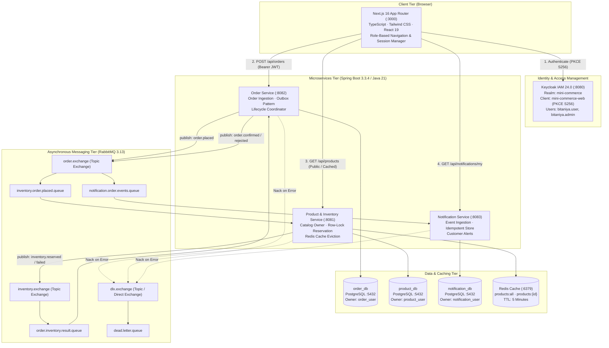
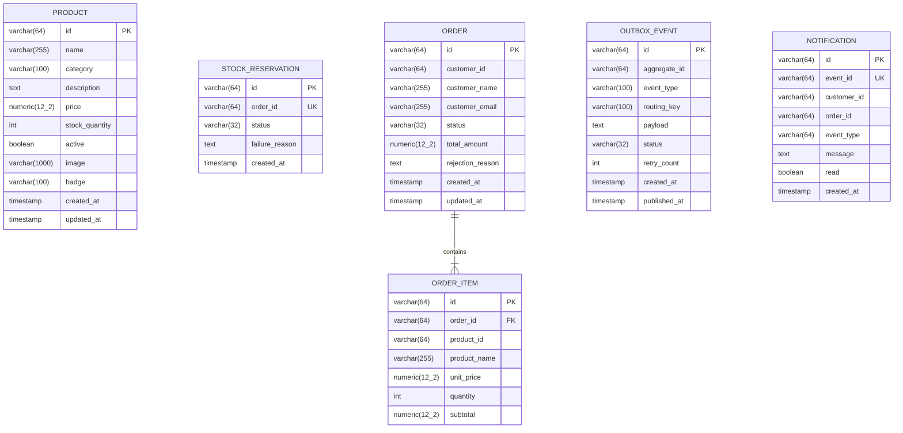

# Aurora Hardware — Enterprise System Documentation
### Event-Driven Microservices Order & Inventory Management Platform

<p align="center">
  
</p>

<p align="center">
  
</p>

---

> 📥 **Official Publication**: **[Download Project Documentation PDF (14 Pages)](PROJECT_DOCUMENTATION.pdf)** | **[Technical Deep Dive PDF (12 Pages)](TECHNICAL_DEEP_DIVE.pdf)**

---

## 1. Executive Summary & System Overview

**Aurora Hardware** (Mini Commerce) is a distributed, enterprise-grade, event-driven e-commerce platform built to solve high-concurrency order placement, real-time inventory reservation, and customer notification workflows without data loss or race-condition overselling.

The system is built on a **microservices-first architecture**, strictly enforcing **Database-per-Service** separation and **asynchronous choreography** via message broker queues.

### 1.1 Architectural Mission & Core Guarantees
1. **Asynchronous Event-Driven Choreography**: Services communicate via RabbitMQ topic exchanges, decoupling business transactions and guaranteeing non-blocking HTTP responses in under 20ms.
2. **Pessimistic Concurrency Control**: Prevents inventory overselling under extreme flash-sale contention using PostgreSQL row-level locks (`SELECT ... FOR UPDATE`).
3. **Database-Per-Service Isolation**: Three independent PostgreSQL databases (`product_db`, `order_db`, `notification_db`) with zero table sharing or cross-database foreign keys.
4. **ACID Transactional Outbox Pattern**: Guarantees at-least-once message dispatch even during broker downtime or network partitions.
5. **Consumer Idempotency**: Strict unique constraints in PostgreSQL (`stock_reservations.order_id`, `notifications.event_id`) discard redelivered messages without duplicate deductions or notifications.
6. **Zero-Trust Identity & Access Management (IAM)**: Keycloak 24.0 OAuth2 / OpenID Connect service utilizing PKCE S256 for public browser clients and cryptographic JWT signature validation.
7. **Ultra-Low Latency Catalog Caching**: Multi-tiered Redis 7 caching with a 5-minute TTL and atomic cache eviction on stock reservation and inventory mutation.
8. **Apple-Grade Luxury UI**: Responsive Next.js 16 (React 19) App Router frontend with real-time order polling, dark/light ambient aesthetics, and auto-detecting user role authorization.

---

## 2. High-Level System Architecture & Design

### 2.1 Multi-Tier System Topology



### 2.2 Component & Network Port Mapping

| Component | Container Name | Host Port | Internal Port | Protocol | Purpose |
| :--- | :--- | :---: | :---: | :--- | :--- |
| **Next.js Frontend** | `minicommerce-frontend` | `3000` | `3000` | HTTP | Customer storefront & Admin operations portal |
| **Product Service** | `minicommerce-product-service` | `8081` | `8081` | HTTP / REST | Catalog CRUD, pessimistic stock reservations |
| **Order Service** | `minicommerce-order-service` | `8082` | `8082` | HTTP / REST | Order placement, Outbox publisher, status transition |
| **Notification Service**| `minicommerce-notification-service` | `8083` | `8083` | HTTP / REST | In-app alerts, read status tracking |
| **Keycloak IAM** | `minicommerce-keycloak` | `8080` | `8080` | HTTP | OAuth2 token provider, PKCE verification, JWKS endpoint |
| **RabbitMQ AMQP** | `minicommerce-rabbitmq` | `5672` | `5672` | AMQP 0-9-1 | Asynchronous message broker for all domain events |
| **RabbitMQ Admin** | `minicommerce-rabbitmq` | `15672` | `15672` | HTTP | Broker monitoring console (`guest` / `guest`) |
| **PostgreSQL** | `minicommerce-postgres` | `5432` | `5432` | PostgreSQL | Hosts `product_db`, `order_db`, `notification_db` |
| **Redis Cache** | `minicommerce-redis` | `6379` | `6379` | RESP | In-memory catalog response caching |

---

## 3. Database Architecture & Complete DDL Schemas

Each microservice manages its own isolated PostgreSQL database schema. No service has access credentials to another service's database.



### 3.1 Product Service Database (`product_db`)

```sql
-- Database: product_db
-- Owner: product_user

CREATE TABLE products (
    id VARCHAR(64) PRIMARY KEY,
    name VARCHAR(255) NOT NULL,
    category VARCHAR(100),
    description TEXT,
    price NUMERIC(12, 2) NOT NULL CHECK (price >= 0.0),
    stock_quantity INTEGER NOT NULL CHECK (stock_quantity >= 0),
    active BOOLEAN NOT NULL DEFAULT TRUE,
    image VARCHAR(1000),
    badge VARCHAR(100),
    created_at TIMESTAMP WITHOUT TIME ZONE NOT NULL DEFAULT NOW(),
    updated_at TIMESTAMP WITHOUT TIME ZONE NOT NULL DEFAULT NOW()
);

CREATE TABLE stock_reservations (
    id VARCHAR(64) PRIMARY KEY,
    order_id VARCHAR(64) NOT NULL UNIQUE,
    status VARCHAR(32) NOT NULL, -- RESERVED | FAILED
    failure_reason TEXT,
    created_at TIMESTAMP WITHOUT TIME ZONE NOT NULL DEFAULT NOW()
);

CREATE INDEX idx_products_active ON products(active);
CREATE INDEX idx_products_category ON products(category);
CREATE INDEX idx_reservations_order_id ON stock_reservations(order_id);
```

### 3.2 Order Service Database (`order_db`)

```sql
-- Database: order_db
-- Owner: order_user

CREATE TABLE orders (
    id VARCHAR(64) PRIMARY KEY,
    customer_id VARCHAR(64) NOT NULL,
    customer_name VARCHAR(255),
    customer_email VARCHAR(255),
    status VARCHAR(32) NOT NULL, -- PENDING | CONFIRMED | REJECTED
    total_amount NUMERIC(12, 2) NOT NULL CHECK (total_amount >= 0.0),
    rejection_reason TEXT,
    created_at TIMESTAMP WITHOUT TIME ZONE NOT NULL DEFAULT NOW(),
    updated_at TIMESTAMP WITHOUT TIME ZONE NOT NULL DEFAULT NOW()
);

CREATE TABLE order_items (
    id VARCHAR(64) PRIMARY KEY,
    order_id VARCHAR(64) NOT NULL REFERENCES orders(id) ON DELETE CASCADE,
    product_id VARCHAR(64) NOT NULL,
    product_name VARCHAR(255) NOT NULL, -- Historical Snapshot
    unit_price NUMERIC(12, 2) NOT NULL, -- Historical Snapshot
    quantity INTEGER NOT NULL CHECK (quantity >= 1),
    subtotal NUMERIC(12, 2) NOT NULL
);

CREATE TABLE outbox_events (
    id VARCHAR(64) PRIMARY KEY,
    aggregate_id VARCHAR(64) NOT NULL,
    event_type VARCHAR(100) NOT NULL,
    routing_key VARCHAR(100) NOT NULL,
    payload TEXT NOT NULL,
    status VARCHAR(32) NOT NULL DEFAULT 'PENDING', -- PENDING | PUBLISHED | FAILED
    retry_count INTEGER NOT NULL DEFAULT 0,
    created_at TIMESTAMP WITHOUT TIME ZONE NOT NULL DEFAULT NOW(),
    published_at TIMESTAMP WITHOUT TIME ZONE
);

CREATE INDEX idx_orders_customer_id ON orders(customer_id);
CREATE INDEX idx_orders_created_at ON orders(created_at DESC);
CREATE INDEX idx_outbox_status_created ON outbox_events(status, created_at ASC);
```

### 3.3 Notification Service Database (`notification_db`)

```sql
-- Database: notification_db
-- Owner: notification_user

CREATE TABLE notifications (
    id VARCHAR(64) PRIMARY KEY,
    event_id VARCHAR(64) NOT NULL UNIQUE, -- Consumer Idempotency Guard
    customer_id VARCHAR(64) NOT NULL,
    order_id VARCHAR(64) NOT NULL,
    event_type VARCHAR(64) NOT NULL,     -- OrderPlaced | OrderConfirmed | OrderRejected
    message TEXT NOT NULL,
    read BOOLEAN NOT NULL DEFAULT FALSE,
    created_at TIMESTAMP WITHOUT TIME ZONE NOT NULL DEFAULT NOW()
);

CREATE INDEX idx_notif_customer_id ON notifications(customer_id);
CREATE INDEX idx_notif_created_at ON notifications(created_at DESC);
```

---

## 4. Complete Microservice & Function Dictionary

### 4.1 Common Events Module (`backend/common-events`)

Provides shared event models, domain constants, and payload envelopes shared across all Spring Boot services.

#### `EventConstants.java`
- `EXCHANGE_ORDER = "order.exchange"`: Topic exchange for order lifecycle events.
- `EXCHANGE_INVENTORY = "inventory.exchange"`: Topic exchange for inventory reservation events.
- `EXCHANGE_DLX = "dlx.exchange"`: Dead letter exchange for quarantined failure messages.
- `ROUTING_KEY_ORDER_PLACED = "order.placed"`: Dispatched when an order is submitted as `PENDING`.
- `ROUTING_KEY_INVENTORY_RESERVED = "inventory.reserved"`: Dispatched when inventory is deducted.
- `ROUTING_KEY_INVENTORY_FAILED = "inventory.reservation.failed"`: Dispatched when inventory is insufficient.
- `ROUTING_KEY_ORDER_CONFIRMED = "order.confirmed"`: Dispatched when order transitions to `CONFIRMED`.
- `ROUTING_KEY_ORDER_REJECTED = "order.rejected"`: Dispatched when order transitions to `REJECTED`.
- `ROUTING_KEY_PRODUCT_UPDATED = "product.updated"`: Dispatched upon catalog changes or manual stock updates.
- `ROUTING_KEY_DEAD_LETTER = "dead.letter"`: Direct key for dead-letter queuing.
- `QUEUE_INVENTORY_ORDER_PLACED = "inventory.order.placed.queue"`: Consumed by `product-service`.
- `QUEUE_ORDER_INVENTORY_RESULT = "order.inventory.result.queue"`: Consumed by `order-service`.
- `QUEUE_NOTIFICATION_ORDER_EVENTS = "notification.order.events.queue"`: Consumed by `notification-service`.
- `QUEUE_DEAD_LETTER = "dead.letter.queue"`: Quarantines unprocessable messages.

#### Domain Event Models
1. **`OrderPlacedEvent`**:
   - `eventId` (String, UUID): Unique event identifier.
   - `eventType` (String): `"OrderPlaced"`.
   - `schemaVersion` (String): `"1.0"`.
   - `orderId` (String): Target order identifier.
   - `customerId`, `customerName`, `customerEmail` (String): Customer identity details.
   - `items` (`List<OrderItemPayload>`): Immutable snapshot of ordered items.
   - `totalAmount` (`BigDecimal`): Computed order total.
   - `timestamp` (`Instant`): Event creation timestamp.
2. **`OrderItemPayload`**:
   - `productId`, `productName` (String).
   - `unitPrice` (`BigDecimal`), `quantity` (`int`), `subtotal` (`BigDecimal`).
3. **`InventoryReservedEvent`**:
   - `eventId`, `eventType` (`"InventoryReserved"`), `schemaVersion`.
   - `orderId`, `customerId`, `reservationId` (String), `timestamp` (`Instant`).
4. **`InventoryReservationFailedEvent`**:
   - `eventId`, `eventType` (`"InventoryReservationFailed"`), `schemaVersion`.
   - `orderId`, `customerId`, `reason` (String), `timestamp` (`Instant`).
5. **`OrderConfirmedEvent`**:
   - `eventId`, `eventType` (`"OrderConfirmed"`), `schemaVersion`.
   - `orderId`, `customerId` (String), `totalAmount` (`BigDecimal`), `timestamp` (`Instant`).
6. **`OrderRejectedEvent`**:
   - `eventId`, `eventType` (`"OrderRejected"`), `schemaVersion`.
   - `orderId`, `customerId`, `reason` (String), `timestamp` (`Instant`).
7. **`ProductUpdatedEvent`**:
   - `eventId`, `eventType` (`"ProductUpdated"`).
   - `productId` (String), `action` (String: `"CREATED"` | `"UPDATED"` | `"STOCK_ADJUSTED"`).
   - `newStockQuantity` (`int`), `timestamp` (`Instant`).

---

### 4.2 Product & Inventory Service (`product-service` — Port 8081)

#### 1. `ProductController.java`
- `getAllProducts()`:
  - **Path**: `GET /api/products`
  - **Security**: Public / Authenticated.
  - **Returns**: `200 OK` with `List<Product>`. Leverages Redis cache (`products:all`).
- `getProductById(String id)`:
  - **Path**: `GET /api/products/{id}`
  - **Security**: Public / Authenticated.
  - **Returns**: `200 OK` with `Product`, or `404 Not Found`. Leverages Redis cache (`products:detail`).
- `createProduct(@Valid @RequestBody Product product)`:
  - **Path**: `POST /api/products`
  - **Security**: `ROLE_ADMIN`.
  - **Returns**: `201 Created` with saved `Product`. Evicts Redis cache, publishes `ProductUpdatedEvent`.
- `updateProduct(@PathVariable String id, @RequestBody Product patch)`:
  - **Path**: `PUT /api/products/{id}`
  - **Security**: `ROLE_ADMIN`.
  - **Returns**: `200 OK` with updated `Product`, or `404 Not Found`. Evicts Redis cache.
- `updateStock(@PathVariable String id, @RequestBody Map<String, Object> body)`:
  - **Path**: `PATCH /api/products/{id}/stock`
  - **Security**: `ROLE_ADMIN`.
  - **Payload**: `{"stockQuantity": 15}`.
  - **Returns**: `200 OK` with updated `Product`, or `400 Bad Request` if negative, `404 Not Found`.

#### 2. `ProductService.java`
- `getAllProducts()`: Annotated `@Cacheable(value = "products:all")`. Queries `productRepository.findByActiveTrueOrderByCreatedAtDesc()` on cache miss.
- `getProductById(String id)`: Annotated `@Cacheable(value = "products:detail", key = "#id")`.
- `createProduct(Product product)`: Annotated `@CacheEvict(allEntries = true)`. Persists new product, invokes `publishProductUpdatedEvent()`.
- `updateProduct(String id, Product patch)`: Evicts cache, applies patched fields, saves product, publishes event.
- `updateStock(String id, int newStock)`: Pessimistically locks product via `findByIdWithLock(id)`, sets new stock, commits, evicts cache, and emits `ProductUpdatedEvent`.
- `seedInitialProducts()`: `@PostConstruct` method. Seeds 7 flagship hardware products (iPhone 16 Pro Max, MacBook Pro M4 Max, Sony WH-1000XM5, Galaxy S25 Ultra, PS5 Pro, Apple Watch Ultra 2, iPad Pro M4) if catalog is empty.

#### 3. `InventoryReservationService.java`
- `processOrderReservation(OrderPlacedEvent event)`:
  - Annotated `@Transactional`.
  - **Idempotency Step**: Checks `stockReservationRepository.existsByOrderId(orderId)`. If true, skips processing to prevent duplicate reservation.
  - **Locking & Validation Step**: Iterates through each `OrderItemPayload` and acquires row-level write lock via `productRepository.findByIdWithLock(productId)`.
  - **Sufficient Stock Branch**:
    1. Decrements `stockQuantity = stockQuantity - item.quantity` for each product.
    2. Writes `StockReservation` with `status = "RESERVED"`.
    3. Calls `evictCatalogCache()` on Redis cache manager.
    4. Emits `InventoryReservedEvent` to `inventory.exchange` with routing key `inventory.reserved`.
  - **Insufficient Stock Branch**:
    1. Leaves stock quantities completely untouched (zero stock loss).
    2. Writes `StockReservation` with `status = "FAILED"` and stores `failureReason`.
    3. Emits `InventoryReservationFailedEvent` to `inventory.exchange` with routing key `inventory.reservation.failed`.
- `evictCatalogCache()`: Clears `products:all` and `products:detail` caches in Redis.

#### 4. `OrderPlacedListener.java`
- `handleOrderPlaced(OrderPlacedEvent event, Channel channel, long deliveryTag)`:
  - Annotated `@RabbitListener(queues = EventConstants.QUEUE_INVENTORY_ORDER_PLACED, ackMode = "MANUAL")`.
  - Invokes `inventoryReservationService.processOrderReservation(event)`.
  - Calls `channel.basicAck(deliveryTag, false)` upon successful commit.
  - On unhandled exception, calls `channel.basicNack(deliveryTag, false, false)` to reroute poison pill message to DLQ.

#### 5. `ProductRepository.java`
- `findByActiveTrueOrderByCreatedAtDesc()`: Returns list of visible catalog items.
- `findByCategoryIgnoreCaseAndActiveTrue(String category)`: Returns filtered active products.
- `findByIdWithLock(String id)`:
  - Annotated `@Lock(LockModeType.PESSIMISTIC_WRITE)`.
  - Custom JPQL: `SELECT p FROM Product p WHERE p.id = :id`.
  - Issues SQL `SELECT ... FOR UPDATE` to lock row until transaction completion.

#### 6. `StockReservationRepository.java`
- `existsByOrderId(String orderId)`: Idempotency predicate query.
- `findByOrderId(String orderId)`: Retrieves existing reservation details.

#### 7. `RedisConfig.java` & `SecurityConfig.java`
- `RedisConfig`: Configures `RedisCacheManager` with JSON serializer, disabled null caching, and explicit 5-minute TTL.
- `SecurityConfig`: Configures CORS for `http://localhost:3000`, disables CSRF, restricts endpoints by `hasRole("ADMIN")`, and registers `KeycloakRealmRoleConverter` to map `roles` claims to Spring Security authorities.

---

### 4.3 Order Service (`order-service` — Port 8082)

#### 1. `OrderController.java`
- `createOrder(@Valid @RequestBody CreateOrderRequest request, @AuthenticationPrincipal Jwt jwt)`:
  - **Path**: `POST /api/orders`
  - **Security**: `ROLE_USER`.
  - **Validation**: Checks that items list is non-empty and quantities are positive.
  - **Context**: Extracts `customerId = jwt.getSubject()`, `customerName`, `customerEmail`.
  - **Returns**: `202 Accepted` with newly created `Order` entity (status: `PENDING`).
- `getMyOrders(@AuthenticationPrincipal Jwt jwt)`:
  - **Path**: `GET /api/orders/my`
  - **Security**: `ROLE_USER`.
  - **Returns**: `200 OK` with customer's personal orders ordered by creation date descending.
- `getOrderById(@PathVariable String id, @AuthenticationPrincipal Jwt jwt, Authentication auth)`:
  - **Path**: `GET /api/orders/{id}`
  - **Security**: Customer Owner or `ROLE_ADMIN`.
  - **Returns**: `200 OK` with order details, or `403 Forbidden` if caller does not own the order.
- `getAllOrders()`:
  - **Path**: `GET /api/orders`
  - **Security**: `ROLE_ADMIN`.
  - **Returns**: `200 OK` with all orders across all customers.

#### 2. `OrderService.java`
- `placeOrder(String customerId, String name, String email, List<OrderItem> items)`:
  - Annotated `@Transactional`.
  - Computes subtotal per item and gross order total.
  - Creates `Order` with `status = OrderStatus.PENDING`.
  - Inserts order items as historical price/name snapshots.
  - Persists `Order` to `order_db.orders`.
  - Serializes `OrderPlacedEvent` and inserts into `order_db.outbox_events` as `status = 'PENDING'`.
  - Publishes event to `order.exchange` (`order.placed`). If successful, updates outbox to `PUBLISHED`.
- `confirmOrder(String orderId)`:
  - Annotated `@Transactional`.
  - **Idempotency Guard**: If `order.getStatus() == OrderStatus.CONFIRMED`, skips processing.
  - Updates status to `OrderStatus.CONFIRMED`.
  - Saves entity and publishes `OrderConfirmedEvent` to `order.exchange` (`order.confirmed`).
- `rejectOrder(String orderId, String reason)`:
  - Annotated `@Transactional`.
  - **Idempotency Guard**: If `order.getStatus() == OrderStatus.REJECTED`, skips processing.
  - Updates status to `OrderStatus.REJECTED` and sets `rejectionReason`.
  - Saves entity and publishes `OrderRejectedEvent` to `order.exchange` (`order.rejected`).
- `getOrdersByCustomer(String customerId)`: Returns orders matching customer UUID.
- `getAllOrders()`: Returns all orders system-wide.
- `getOrderById(String orderId)`: Returns `Optional<Order>`.

#### 3. `OutboxPublisherService.java`
- `publishPendingOutboxEvents()`:
  - Annotated `@Scheduled(fixedDelay = 5000)`.
  - Queries `outboxEventRepository.findTop50ByStatusOrderByCreatedAtAsc("PENDING")`.
  - Re-publishes unconfirmed events to RabbitMQ with exponential retry tracking.
  - Marks successfully dispatched records as `PUBLISHED`.

#### 4. `InventoryResultListener.java`
- `handleInventoryEvent(Message message, Channel channel, long deliveryTag)`:
  - Annotated `@RabbitListener(queues = EventConstants.QUEUE_ORDER_INVENTORY_RESULT, ackMode = "MANUAL")`.
  - Evaluates routing key:
    - If `inventory.reserved`: Deserializes `InventoryReservedEvent` and invokes `orderService.confirmOrder(orderId)`.
    - If `inventory.reservation.failed`: Deserializes `InventoryReservationFailedEvent` and invokes `orderService.rejectOrder(orderId, reason)`.
  - Calls `channel.basicAck(deliveryTag, false)` on success.
  - Calls `channel.basicNack(deliveryTag, false, false)` to DLQ on unrecoverable error.

---

### 4.4 Notification Service (`notification-service` — Port 8083)

#### 1. `NotificationController.java`
- `getMyNotifications(@AuthenticationPrincipal Jwt jwt)`:
  - **Path**: `GET /api/notifications/my`
  - **Security**: `ROLE_USER`.
  - **Returns**: `200 OK` with customer's notifications.
- `markAsRead(@PathVariable String id, @AuthenticationPrincipal Jwt jwt)`:
  - **Path**: `PATCH /api/notifications/{id}/read`
  - **Security**: Notification Owner.
  - **Returns**: `200 OK` with updated notification, or `403 Forbidden` if caller does not own it.
- `getAllNotifications()`:
  - **Path**: `GET /api/notifications`
  - **Security**: `ROLE_ADMIN`.
  - **Returns**: `200 OK` with all notifications across all customers.

#### 2. `NotificationService.java`
- `recordNotification(String eventId, String customerId, String orderId, String eventType, String message)`:
  - Annotated `@Transactional`.
  - **Idempotency Guard**: Checks `notificationRepository.existsByEventId(eventId)`. Skips insertion if event has already been recorded.
  - Persists new `Notification` entity with `read = false`.
- `getNotificationsForCustomer(String customerId)`: Returns notifications by customer ID.
- `getAllNotifications()`: Returns all notifications for administrative audit.
- `markAsRead(String notificationId, String customerId)`: Verifies notification ownership and sets `read = true`.

#### 3. `OrderLifecycleListener.java`
- `handleOrderEvent(Message message, Channel channel, long deliveryTag)`:
  - Annotated `@RabbitListener(queues = EventConstants.QUEUE_NOTIFICATION_ORDER_EVENTS, ackMode = "MANUAL")`.
  - Ingests `OrderPlacedEvent` (`order.placed`) ➔ Formats alert: `"Order #... submitted. Checking stock availability asynchronously..."`.
  - Ingests `OrderConfirmedEvent` (`order.confirmed`) ➔ Formats alert: `"Great news! Order #... has been CONFIRMED. Hardware stock is reserved and verified."`.
  - Ingests `OrderRejectedEvent` (`order.rejected`) ➔ Formats alert: `"Order #... could not be fulfilled: ..."`.
  - Calls `channel.basicAck(deliveryTag, false)` on success; `channel.basicNack(deliveryTag, false, false)` to DLQ on failure.

---

## 5. Frontend Architecture & Component Dictionary (Next.js 16)

The frontend is built using **Next.js 16 (App Router)** with **React 19**, **Tailwind CSS**, and **Lucide React**.

### 5.1 Component Hierarchy
```
frontend/
├── app/
│   ├── layout.tsx                # Root layout with font imports, brand favicon, and meta tags
│   ├── page.tsx                  # Root landing page mounting MiniCommerceApp
│   └── [...slug]/page.tsx        # Catch-all route enabling client-side URL history (/shop, /orders, /admin)
└── components/
    ├── minicommerce-app.tsx      # Master state container, route guard, and session hydration
    ├── navbar.tsx                # Dynamic top header with persona switches and cart drawer trigger
    ├── landing-hero.tsx          # Flagship editorial hero presenting brand value propositions
    ├── shop-view.tsx             # Interactive hardware catalog with instant search & category filters
    ├── product-detail-modal.tsx  # Modal window showcasing hardware specs and real-time inventory
    ├── cart-drawer.tsx           # Slide-out shopping bag drawer with quantity adjusters
    ├── checkout-view.tsx         # Authenticated checkout screen with order review and pricing breakdown
    ├── orders-view.tsx           # Customer orders monitor with 3-stage visual timeline & polling
    ├── admin-view.tsx            # Executive store analytics, stock adjusters, and fulfillment ledger
    ├── login-view.tsx            # Keycloak login form featuring 1-click test credential chips
    └── footer.tsx                # Minimalist footer with brand icon and enterprise copyright
```

### 5.2 Frontend Component Specifications

#### 1. `MiniCommerceApp` (`components/minicommerce-app.tsx`)
- **State Management**: Holds `currentView`, `currentUser`, `products`, `cart`, `orders`, `notifications`, `selectedProduct`.
- **Session Hydration**: On component mount, calls `getStoredUser()` and verifies token validity via `ApiClient.ensureValidToken()`.
- **Preemptive Token Heartbeat**: Executes every 45 seconds to refresh access tokens within 10 seconds of expiry.
- **Role-Based Navigation (`navigateTo`)**:
  - Enforces access control before changing view.
  - If anonymous user accesses `/orders`, `/checkout`, or `/admin`, reroutes to `login`.
  - If customer user accesses `/admin`, reroutes to `shop`.
  - If admin user logs in, immediately sets view to `admin` without interstitial screens.
  - Synchronizes browser URL history via `window.history.pushState()`.

#### 2. `Navbar` (`components/navbar.tsx`)
- Displays brand SVG logo (`/brand/aurora-logo.svg`) and brand icon (`/brand/aurora-mark.svg`).
- Renders navigation links: **Hardware Catalog**, **My Orders**, **Admin Console**.
- Displays shopping cart trigger button with animated item badge count.
- Displays authenticated user profile badge and session countdown timer.

#### 3. `LandingHero` (`components/landing-hero.tsx`)
- Hero banner with headline copy: *"Precision Engineering. Uncompromising Performance."*
- Features quick CTA buttons navigating directly to the catalog (`shop`) or orders monitor.

#### 4. `ShopView` (`components/shop-view.tsx`)
- Category filter pills: All, Smartphones, Laptops, Audio, Gaming, Wearables, Tablets.
- Live keyword search input matching product name and description.
- Renders responsive product grid with hardware photographs, price tags, badges, and real-time stock meters.
- Clicking a product opens the `ProductDetailModal`; clicking "Add to Bag" updates the cart state.

#### 5. `CartDrawer` (`components/cart-drawer.tsx`)
- Slide-out backdrop drawer displaying added line items.
- Item quantity increment (`+`) and decrement (`-`) buttons.
- Subtotal computation and dynamic shipping fee calculation.
- Direct "Proceed to Checkout" button routing to `checkout` view.

#### 6. `CheckoutView` (`components/checkout-view.tsx`)
- Order summary review showing selected products, quantities, unit prices, and computed gross total.
- Authenticated user info review (Name, Email, Delivery Address).
- "Submit Order" button: invokes `ApiClient.placeOrder()`, clears shopping cart, and transitions user directly to `/orders`.

#### 7. `OrdersView` (`components/orders-view.tsx`)
- Active order polling: calls `ApiClient.getMyOrders()` every 1,500ms when pending orders exist.
- 3-stage visual timeline stepper:
  - Step 1: **Order Submitted** (Always complete upon placement).
  - Step 2: **Inventory Reservation** (Pessimistic row lock in `product-service`).
  - Step 3: **Final Status** (`CONFIRMED` in emerald green, or `REJECTED` in crimson red).
- Displays rejection reason banner if reservation failed due to stock exhaustion.

#### 8. `AdminView` (`components/admin-view.tsx`)
- Restricted strictly to callers holding `ROLE_ADMIN`.
- **Top KPI Cards**:
  - *Total Gross Revenue*: Sum of all confirmed orders.
  - *Total Confirmed Orders*: Count of completed purchases.
  - *Total Catalog SKUs*: Count of registered products.
  - *Low Stock Warnings*: Count of products with stock < 5 units.
- **Inventory Adjustment Table**: Direct stock level increment/decrement controls invoking `PATCH /api/products/{id}/stock`.
- **Store Fulfillment Ledger**: Complete historical table of all orders across all customers with live status badges.
- **Hooks Compliance**: All 5 `useMemo` hooks execute unconditionally before any role guard return statement.

#### 9. `LoginView` (`components/login-view.tsx`)
- Form inputs for username and password.
- **1-Click Test Credential Chips**:
  - `Customer (bitaniya.user)`: Pre-fills `bitaniya.user` / `password123`.
  - `Administrator (bitaniya.admin)`: Pre-fills `bitaniya.admin` / `adminPass2026`.
- Calls `ApiClient.login()`, updates session in `localStorage`, and triggers immediate navigation.

---

### 5.3 Complete API Client Method Dictionary (`frontend/lib/api-client.ts`)

| Method Name | Parameters | Return Type | HTTP Request | Description |
| :--- | :--- | :--- | :--- | :--- |
| `login` | `username: string, password: string` | `Promise<UserProfile>` | `POST /realms/mini-commerce/protocol/openid-connect/token` | Authenticates against Keycloak using `grant_type=password`, decodes JWT claims, detects roles, and stores session. |
| `refreshToken` | `user: UserProfile` | `Promise<UserProfile>` | `POST /realms/mini-commerce/protocol/openid-connect/token` | Exchanges `refresh_token` with Keycloak for a fresh access token without user prompt. |
| `ensureValidToken` | `user: UserProfile` | `Promise<UserProfile>` | Internal check + `refreshToken` | Validates if token is within 10s of expiry; transparently refreshes token if needed. |
| `getSessionStatus` | `user: UserProfile \| null` | `{isValid: boolean, remainingSeconds: number, formattedRemaining: string}` | Synchronous helper | Computes remaining session lifespan in minutes/seconds for UI countdown badge. |
| `getProducts` | None | `Promise<Product[]>` | `GET /api/products` (Port 8081) | Fetches active products from Product Service (served via Redis cache). |
| `getProductById` | `id: string` | `Promise<Product \| null>` | `GET /api/products/{id}` (Port 8081) | Fetches product details by ID (served via Redis cache). |
| `createProduct` | `user: UserProfile, data: ProductDTO` | `Promise<Product>` | `POST /api/products` (Port 8081) | Creates new hardware product. Restricted to `ROLE_ADMIN`. |
| `updateProduct` | `user: UserProfile, id: string, patch: Partial<Product>` | `Promise<Product>` | `PUT /api/products/{id}` (Port 8081) | Updates product details. Restricted to `ROLE_ADMIN`. |
| `updateStock` | `user: UserProfile, id: string, newStock: number` | `Promise<Product>` | `PATCH /api/products/{id}/stock` (Port 8081) | Modifies inventory stock count. Restricted to `ROLE_ADMIN`. |
| `placeOrder` | `user: UserProfile, itemsToOrder: Array` | `Promise<Order>` | `POST /api/orders` (Port 8082) | Submits customer order. Restricted to `ROLE_USER`. Returns HTTP 202. |
| `getMyOrders` | `user: UserProfile` | `Promise<Order[]>` | `GET /api/orders/my` (Port 8082) | Retrieves authenticated user's order history. Restricted to `ROLE_USER`. |
| `getAllOrders` | `user: UserProfile` | `Promise<Order[]>` | `GET /api/orders` (Port 8082) | Retrieves all orders across all customers. Restricted to `ROLE_ADMIN`. |
| `getOrderById` | `user: UserProfile, orderId: string` | `Promise<Order>` | `GET /api/orders/{orderId}` (Port 8082) | Retrieves order details if owner or `ROLE_ADMIN`. |
| `getMyNotifications` | `user: UserProfile` | `Promise<CustomerNotification[]>` | `GET /api/notifications/my` (Port 8083) | Retrieves authenticated user's notifications. Restricted to `ROLE_USER`. |
| `markNotificationAsRead` | `user: UserProfile, id: string` | `Promise<void>` | `PATCH /api/notifications/{id}/read` (Port 8083) | Flips notification `read = true`. Caller must own notification. |
| `getAllNotifications` | `user: UserProfile` | `Promise<CustomerNotification[]>` | `GET /api/notifications` (Port 8083) | Retrieves all system notifications. Restricted to `ROLE_ADMIN`. |

---

## 6. Complete REST API Reference Specification

### 6.1 Product & Inventory Service Endpoints (Port 8081)

#### `GET /api/products`
- **Description**: Returns all active hardware products.
- **Headers**: None required.
- **Response**: `200 OK`
```json
[
  {
    "id": "prod-iphone-16-pro",
    "name": "iPhone 16 Pro Max",
    "category": "Smartphones",
    "description": "Grade 5 titanium design with sculpted edges, 48MP camera, and A18 Pro chip.",
    "price": 49999.00,
    "stockQuantity": 14,
    "active": true,
    "image": "https://images.unsplash.com/photo-1696446701796-da61225697cc?auto=format&fit=crop&w=1200&q=85",
    "badge": "Flagship",
    "createdAt": "2026-10-12T09:28:10.000Z",
    "updatedAt": "2026-10-12T09:28:10.000Z"
  }
]
```

#### `PATCH /api/products/{id}/stock`
- **Description**: Adjusts product stock level directly.
- **Headers**: `Authorization: Bearer <ADMIN_JWT>`
- **Request Body**:
```json
{
  "stockQuantity": 25
}
```
- **Response**: `200 OK` with updated Product entity.
- **Errors**: `400 Bad Request` (negative stock), `401 Unauthorized`, `403 Forbidden` (non-admin), `404 Not Found`.

---

### 6.2 Order Service Endpoints (Port 8082)

#### `POST /api/orders`
- **Description**: Submits an order for processing.
- **Headers**: `Authorization: Bearer <USER_JWT>`
- **Request Body**:
```json
{
  "items": [
    {
      "productId": "prod-iphone-16-pro",
      "productName": "iPhone 16 Pro Max",
      "unitPrice": 49999.00,
      "quantity": 1
    }
  ]
}
```
- **Response**: `202 Accepted`
```json
{
  "id": "ord-7f3941b2",
  "customerId": "f3e51fd0-dd18-4274-baa5-7f363041bf12",
  "customerName": "Bitaniya User",
  "customerEmail": "bitaniya.user@minicommerce.local",
  "status": "PENDING",
  "totalAmount": 49999.00,
  "rejectionReason": null,
  "items": [
    {
      "id": "item-98a123bc",
      "productId": "prod-iphone-16-pro",
      "productName": "iPhone 16 Pro Max",
      "unitPrice": 49999.00,
      "quantity": 1,
      "subtotal": 49999.00
    }
  ],
  "createdAt": "2026-10-12T10:26:47.900Z",
  "updatedAt": "2026-10-12T10:26:47.900Z"
}
```

#### `GET /api/orders/my`
- **Description**: Retrieves current customer's orders.
- **Headers**: `Authorization: Bearer <USER_JWT>`
- **Response**: `200 OK` with `List<Order>`.

#### `GET /api/orders`
- **Description**: Retrieves all store orders. Restricted to admin.
- **Headers**: `Authorization: Bearer <ADMIN_JWT>`
- **Response**: `200 OK` with `List<Order>`.

---

### 6.3 Notification Service Endpoints (Port 8083)

#### `GET /api/notifications/my`
- **Description**: Retrieves current customer's notifications.
- **Headers**: `Authorization: Bearer <USER_JWT>`
- **Response**: `200 OK`
```json
[
  {
    "id": "notif-449102ab",
    "eventId": "20995fcb-bc50-420e-805e-f87d9d4f2f96",
    "customerId": "f3e51fd0-dd18-4274-baa5-7f363041bf12",
    "orderId": "ord-7f3941b2",
    "eventType": "OrderConfirmed",
    "message": "Great news! Order #ORD-7F3941B2 has been CONFIRMED. Hardware stock is reserved and verified.",
    "read": false,
    "createdAt": "2026-10-12T10:26:48.012Z"
  }
]
```

#### `PATCH /api/notifications/{id}/read`
- **Description**: Marks notification as read.
- **Headers**: `Authorization: Bearer <USER_JWT>`
- **Response**: `200 OK` with updated notification.

---

## 7. RabbitMQ Topology & Event Contracts

### 7.1 Topic Exchange & Queue Matrix

| Exchange Name | Exchange Type | Routing Key | Target Queue | Consumers | Purpose |
| :--- | :--- | :--- | :--- | :--- | :--- |
| **`order.exchange`** | Topic | `order.placed` | `inventory.order.placed.queue` | `product-service` | Triggers row-locked stock reservation |
| **`order.exchange`** | Topic | `order.placed` | `notification.order.events.queue` | `notification-service` | Informs user of order submission |
| **`inventory.exchange`** | Topic | `inventory.reserved` | `order.inventory.result.queue` | `order-service` | Finalizes order to `CONFIRMED` |
| **`inventory.exchange`** | Topic | `inventory.reservation.failed`| `order.inventory.result.queue` | `order-service` | Finalizes order to `REJECTED` |
| **`order.exchange`** | Topic | `order.confirmed` | `notification.order.events.queue` | `notification-service` | Informs user of order confirmation |
| **`order.exchange`** | Topic | `order.rejected` | `notification.order.events.queue` | `notification-service` | Informs user of order rejection |
| **`inventory.exchange`** | Topic | `product.updated` | *(Optional telemetry)* | *(Auditing)* | Catalog or inventory stock change |
| **`dlx.exchange`** | Topic / Direct | `dead.letter` | `dead.letter.queue` | Ops / Admin | Quarantined poison pill messages |

---

## 8. Role-Based Access Control (RBAC) Matrix

| Resource URI | HTTP Verb | Anonymous Caller | `USER` Role | `ADMIN` Role |
| :--- | :---: | :---: | :---: | :---: |
| `GET /api/products` | GET | Allowed (200) | Allowed (200) | Allowed (200) |
| `GET /api/products/{id}` | GET | Allowed (200) | Allowed (200) | Allowed (200) |
| `POST /api/products` | POST | Denied (401) | Denied (403) | **Allowed (201)** |
| `PUT /api/products/{id}` | PUT | Denied (401) | Denied (403) | **Allowed (200)** |
| `PATCH /api/products/{id}/stock` | PATCH | Denied (401) | Denied (403) | **Allowed (200)** |
| `POST /api/orders` | POST | Denied (401) | **Allowed (202)** | Denied (403) |
| `GET /api/orders/my` | GET | Denied (401) | **Allowed (200)** | Denied (403) |
| `GET /api/orders/{id}` | GET | Denied (401) | Allowed (Owner only) | **Allowed (200)** |
| `GET /api/orders` | GET | Denied (401) | Denied (403) | **Allowed (200)** |
| `GET /api/notifications/my` | GET | Denied (401) | **Allowed (200)** | Denied (403) |
| `PATCH /api/notifications/{id}/read` | PATCH | Denied (401) | Allowed (Owner only) | Allowed (Owner only) |
| `GET /api/notifications` | GET | Denied (401) | Denied (403) | **Allowed (200)** |

---

## 9. Verification & Operational Health Check

### 9.1 Verification Command Reference

```bash
# 1. Compile and execute backend unit tests across all microservices
cd backend && mvn clean test

# 2. Type-check frontend code with TypeScript compiler
cd frontend && pnpm tsc --noEmit

# 3. Build frontend production bundle with Next.js Turbopack
cd frontend && pnpm build

# 4. Check status of Docker infrastructure containers
docker compose ps
```

### 9.2 Test Credentials Reference

| Role | Username | Password | Email | Granted Authority |
| :--- | :--- | :--- | :--- | :--- |
| **Customer** | `bitaniya.user` | `password123` | `bitaniya.user@minicommerce.local` | `ROLE_USER` |
| **Administrator** | `bitaniya.admin` | `adminPass2026` | `bitaniya.admin@minicommerce.local` | `ROLE_ADMIN` |

---

<p align="center">
  
  <br />
  <sub>© 2026 Aurora Hardware Inc. Distributed Systems Engineering Group. All rights reserved.</sub>
</p>
