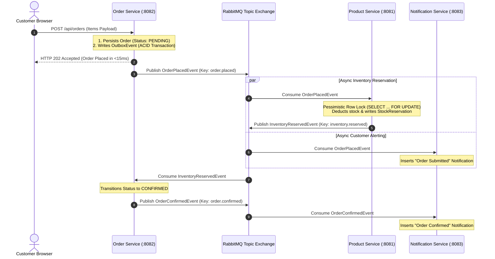
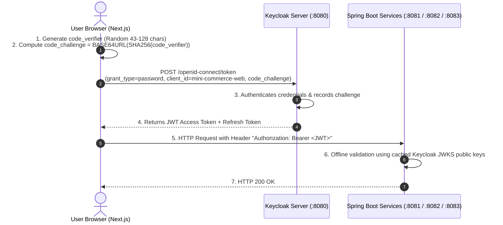
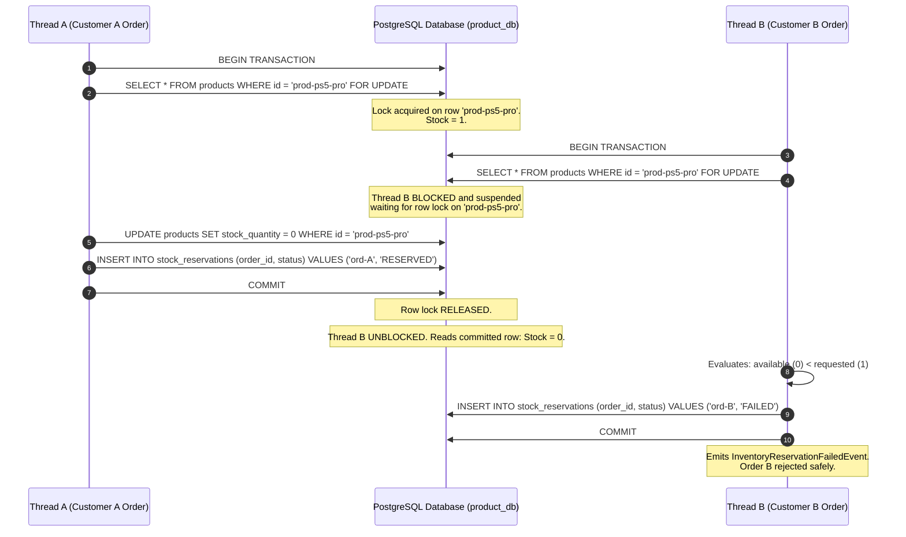
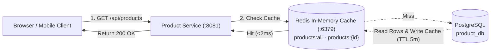

# Aurora Hardware — Architectural Principles, Logic & Engineering Deep Dive
### Comprehensive Technical Explanation of Technologies, Patterns, Algorithms, and Protocols

<p align="center">
  
</p>

<p align="center">
  
</p>

---

> 📥 **Official Publication**: **[Download Technical Deep Dive PDF (12 Pages)](TECHNICAL_DEEP_DIVE.pdf)** | **[Project Documentation PDF (14 Pages)](PROJECT_DOCUMENTATION.pdf)**

---

## 1. Architectural Philosophy: Why Event-Driven Microservices?

### 1.1 The Synchronous Anti-Pattern (Cascading Failure Risk)
In traditional monolithic or synchronous REST microservices architectures, an order placement workflow chains HTTP calls sequentially across services:

```
Browser ──► Order Service ──(HTTP)──► Product Service ──(HTTP)──► Notification Service
```

#### Why This Design Fails in High-Volume Production:
1. **Cascading Latency**: The browser connection remains blocked for the cumulative sum of all downstream network round-trips, thread context switches, and database lock acquisitions:
   $$\text{Total Latency} = T_{\text{Order}} + T_{\text{Network}} + T_{\text{Product}} + T_{\text{Network}} + T_{\text{Notification}}$$
   If any downstream service experiences a garbage collection pause or connection pool stall, the customer checkout spins indefinitely.
2. **Cascading Failure**: If the Notification Service crashes or encounters database connection exhaustion, the entire checkout pipeline fails. The customer receives an error screen even though the inventory was physically available.
3. **The Distributed Transaction Dilemma (Two-Phase Commit)**: If the Product Service successfully reserves stock, but the Notification Service crashes before responding, the Order Service must initiate complex distributed rollbacks (compensating transactions or 2PC) across HTTP boundaries. In practice, network partitions cause rollbacks to fail, leaving stock permanently decremented for orders that were never created.

---

### 1.2 The Asynchronous Event Choreography Solution
In **Aurora Hardware**, the Order Service does not know about or directly depend on the runtime availability of the Product or Notification services. Instead:



#### Architectural Advantages:
- **Instantaneous Customer Response**: The customer receives an immediate **HTTP 202 Accepted** within **12 to 18 milliseconds**, because the Order Service only performs a local database insert and an AMQP dispatch.
- **Fault-Tolerant Buffering**: If the Notification Service is restarting during a software deployment, RabbitMQ safely buffers messages in `notification.order.events.queue`. Once the service comes online, it drains the backlog with zero message loss.
- **Independent Scalability**: During flash sales, `product-service` worker instances can be horizontally scaled independently to absorb stock reservation traffic without modifying `order-service` or `notification-service`.

---

### 1.3 Database-per-Service: The Principle of Data Isolation
Each microservice is bound to its own logically isolated PostgreSQL database:
- `product-service` $\rightarrow$ `product_db` (owned by `product_user`)
- `order-service` $\rightarrow$ `order_db` (owned by `order_user`)
- `notification-service` $\rightarrow$ `notification_db` (owned by `notification_user`)

#### Why Table Sharing is Strictly Prohibited:
1. **Schema Evolution Autonomy**: If `product-service` adds dynamic pricing or international tax attributes to `products`, `order-service` code remains completely untouched.
2. **Historical Snapshotting**: The `order_items` table in `order_db` stores the product name and unit price as an **immutable historical snapshot** taken at the millisecond of order placement:
   ```sql
   -- order_db.order_items
   product_name VARCHAR(255) NOT NULL,
   unit_price   NUMERIC(12, 2) NOT NULL
   ```
   If a store administrator subsequently renames the product or increases its price from \$499 to \$699 in `product_db.products`, past customer invoices and receipts in `order_db` remain historically accurate without needing cross-database joins.

---

## 2. Keycloak IAM Deep Dive: OAuth2, PKCE, & JWT Security

<p align="center">
  
</p>

### 2.1 What is Keycloak and Why is it Used?
**Keycloak** is an open-source, enterprise **Identity and Access Management (IAM)** system governed by Red Hat. In Aurora Hardware, Keycloak serves as the centralized OpenID Connect (OIDC) identity provider.

#### Why Authentication is Externalized:
- **Zero Plaintext Passwords in Application Databases**: Core business services never store password hashes or salt keys. User credentials are securely managed inside Keycloak's isolated credential store using Argon2 / PBKDF2 hashing.
- **Centralized Role Governance**: Customer and administrator permissions are configured globally in the `mini-commerce` realm, preventing inconsistent access rules across different backend microservices.
- **Standardized Cryptographic Tokens**: Emits RFC 7519 JSON Web Tokens (JWT) signed using asymmetric RS256 cryptography.

---

### 2.2 Proof Key for Code Exchange (PKCE with S256 — RFC 7636)

#### The Problem with Client Secrets in Single-Page Apps (SPA):
In a traditional web application running server-side (like Spring MVC), the server stores a secret password called a `client_secret` to authenticate itself to Keycloak.
However, in a client-side Single-Page Application (Next.js running in the user's browser):
- **Any user can open Browser DevTools** (Network / Sources tabs) and extract the client secret from JavaScript bundles.
- A public client secret is not secret. Attackers can steal authorization codes via malicious browser extensions or URI interception and impersonate users.

#### The PKCE Solution:
**PKCE** replaces static client secrets with dynamically generated cryptographic challenges on every authentication request:



#### Cryptographic Steps of PKCE:
1. **Verifier Generation**: The client creates a cryptographically high-entropy random string $V$ (`code_verifier`) between 43 and 128 characters using characters `[A-Z, a-z, 0-9, -, ., _, ~]`.
2. **Challenge Computation**: The client hashes the verifier using SHA-256 and Base64URL encodes the digest:
   $$C = \text{Base64URL}(\text{SHA-256}(V))$$
3. **Challenge Registration**: The client sends $C$ and `code_challenge_method = "S256"` to Keycloak.
4. **Token Verification**: When exchanging the authorization code, the client supplies the original unhashed verifier $V$. Keycloak computes $\text{Base64URL}(\text{SHA-256}(V))$ and verifies that it exactly equals $C$.
5. **Security Guarantee**: Even if an adversary intercepts the authorization code in transit, they cannot redeem it for a JWT without knowledge of $V$.

---

### 2.3 Realm Configuration & Role Mapping

In `docker/keycloak/mini-commerce-realm.json`:
- **Realm**: `mini-commerce`
- **Client**: `mini-commerce-web`
  - `publicClient: true` (indicates no static secret)
  - `standardFlowEnabled: true`
  - `directAccessGrantsEnabled: true` (allows username/password token exchange)
  - `pkce.code.challenge.method: "S256"`
  - `attributes.webOrigins: ["http://localhost:3000", "+"]` (CORS whitelisting)
- **Protocol Mapper**:
  - `name: "realm-roles-mapper"`
  - Injects Keycloak realm roles directly into the root `roles` claim of the access token JWT:
    ```json
    {
      "sub": "f3e51fd0-dd18-4274-baa5-7f363041bf12",
      "preferred_username": "bitaniya.user",
      "email": "bitaniya.user@minicommerce.local",
      "roles": ["USER"],
      "realm_access": {
        "roles": ["USER", "default-roles-mini-commerce"]
      }
    }
    ```

---

### 2.4 Cryptographic Token Validation in Spring Boot

Each Spring Boot microservice operates as an **OAuth2 Resource Server** using `spring-boot-starter-oauth2-resource-server`.

#### Configuration in `application.yml`:
```yaml
spring:
  security:
    oauth2:
      resourceserver:
        jwt:
          issuer-uri: http://localhost:8080/realms/mini-commerce
          jwk-set-uri: http://localhost:8080/realms/mini-commerce/protocol/openid-connect/certs
```

#### How Validation Works:
1. **Public Key Discovery**: On startup, Spring Boot queries the JSON Web Key Set (JWKS) at `http://localhost:8080/realms/mini-commerce/protocol/openid-connect/certs` and caches Keycloak's public RSA certificates locally.
2. **Offline Signature Check**: When an incoming request includes `Authorization: Bearer <token>`, Spring Security validates the signature mathematically against the cached public key. **Zero network calls to Keycloak are required per HTTP request**, guaranteeing sub-millisecond authentication overhead.
3. **Temporal Claims Verification**: Validates that current time $t < \text{exp}$ (expiration) and $t \ge \text{nbf}$ (not before).
4. **Custom Role Converter**:
   In `SecurityConfig.java`:
   ```java
   public static class KeycloakRealmRoleConverter implements Converter<Jwt, Collection<GrantedAuthority>> {
       @Override
       public Collection<GrantedAuthority> convert(Jwt jwt) {
           List<String> roles = jwt.getClaimAsStringList("roles");
           if (roles == null) {
               Map<String, Object> realmAccess = jwt.getClaimAsMap("realm_access");
               if (realmAccess != null && realmAccess.get("roles") instanceof List<?>) {
                   roles = (List<String>) realmAccess.get("roles");
               }
           }
           if (roles == null || roles.isEmpty()) return Collections.emptyList();
           return roles.stream()
                   .map(role -> new SimpleGrantedAuthority("ROLE_" + role.toUpperCase()))
                   .collect(Collectors.toList());
       }
   }
   ```
   This converts the JWT's `["USER"]` or `["ADMIN"]` claims directly into Spring Security `ROLE_USER` or `ROLE_ADMIN` authorities for use with `@PreAuthorize("hasRole('ADMIN')")`.

---

### 2.5 Token Lifecycle & Preemptive Silent Refresh

#### Token Lifespans:
- **Access Token TTL**: 1,800 seconds (30 minutes).
- **Refresh Token TTL / SSO Session Idle**: 3,600 seconds (60 minutes).

#### Preemptive Refresh Algorithm (`frontend/lib/api-client.ts`):
Waiting for an access token to expire causes customer requests to fail with HTTP 401. To prevent this, Aurora Hardware uses a **proactive heartbeat algorithm**:
1. Before every API call, `ApiClient.ensureValidToken(currentUser)` checks if the access token has expired or is within 10 seconds of expiry.
2. Additionally, a background timer in `minicommerce-app.tsx` ticks every **45 seconds**.
3. If an access token is near expiry, the client immediately exchanges the `refresh_token` with Keycloak:
   ```
   POST /realms/mini-commerce/protocol/openid-connect/token
   client_id=mini-commerce-web&grant_type=refresh_token&refresh_token=<RT>
   ```
4. The client receives a fresh access token and updates `localStorage` transparently. The customer never experiences an interrupted session or jarring login redirect.
5. If the refresh token itself has expired (after 60 minutes of inactivity), `ensureValidToken()` catches the error, purges `localStorage`, and cleanly redirects the browser to the login screen.

---

## 3. Concurrency Control & The Anti-Overselling Algorithm

### 3.1 The Flash-Sale Race Condition
Consider a high-demand flagship product (e.g., *PlayStation 5 Pro*) with **1 unit remaining in stock**:
- At `14:00:00.100`, Customer A orders 1 unit.
- At `14:00:00.102`, Customer B orders 1 unit.

#### Failure with Naive Updates:
```
Thread A: Reads stock = 1
Thread B: Reads stock = 1
Thread A: Computes 1 - 1 = 0, Writes stock = 0
Thread B: Computes 1 - 1 = 0, Writes stock = 0
```
**Catastrophic Result**: Both orders confirm, but 2 units were promised for 1 physical unit in the warehouse.

#### Why Optimistic Locking (`@Version`) is Suboptimal:
Under optimistic locking, Thread B's update detects a version mismatch and throws an `OptimisticLockingFailureException`. The application must retry the entire transaction or return an error. Under heavy flash-sale contention (hundreds of shoppers ordering the last unit simultaneously), optimistic lock retry storms cause high CPU spikes and high abort rates.

---

### 3.2 Pessimistic Row Locking (`SELECT ... FOR UPDATE`)
Aurora Hardware solves this at the database engine level using **Pessimistic Write Locking**.

In [ProductRepository.java](file:///Users/m4/Documents/e-commerce-system-architecture/backend/product-service/src/main/java/com/minicommerce/product/repository/ProductRepository.java#L21-L23):
```java
@Lock(LockModeType.PESSIMISTIC_WRITE)
@Query("SELECT p FROM Product p WHERE p.id = :id")
Optional<Product> findByIdWithLock(@Param("id") String id);
```

#### Physical Execution Timeline:



#### Absolute Guarantees:
- **Zero Overselling**: Stock can never drop below zero.
- **Predictable Ordering**: Transactions line up sequentially on PostgreSQL's row-lock queue in exact order of arrival.
- **Safe Abort**: The failed transaction leaves stock untouched and emits a business event (`InventoryReservationFailedEvent`) rather than throwing an unhandled database error.

---

## 4. Reliability & Resiliency Engineering

### 4.1 The Transactional Outbox Pattern

#### The Dual-Write Problem:
When an order is created, the system must perform two distinct mutations:
1. Write the order record into PostgreSQL (`order_db`).
2. Publish an `OrderPlacedEvent` to RabbitMQ.

If the application writes to PostgreSQL and then attempts to publish to RabbitMQ:
```
PostgreSQL Commit (Success) ──► RabbitMQ Disconnect / Network Partition (Failure)
```
The database commit cannot be undone, but RabbitMQ never received the event. The order remains permanently stuck in `PENDING` status, and inventory is never reserved.

#### Aurora Hardware Outbox Implementation:
1. In `OrderService.placeOrder()`:
   Within the **same local ACID database transaction**, the service writes both the `Order` and an `OutboxEvent`:
   ```java
   // Same Transaction
   orderRepository.save(order);
   
   OutboxEvent outbox = new OutboxEvent(
       order.getId(),
       "OrderPlaced",
       EventConstants.ROUTING_KEY_ORDER_PLACED,
       objectMapper.writeValueAsString(event)
   );
   outboxEventRepository.save(outbox);
   ```
2. If the transaction commits, the event is permanently preserved in `order_db.outbox_events`.
3. The service immediately attempts to publish the event to RabbitMQ. If successful, it marks the outbox event as `PUBLISHED`.
4. If RabbitMQ was temporarily unreachable, the background daemon [OutboxPublisherService](file:///Users/m4/Documents/e-commerce-system-architecture/backend/order-service/src/main/java/com/minicommerce/order/service/OutboxPublisherService.java) runs `@Scheduled(fixedDelay = 5000)`:
   - Queries `outbox_events` for `status = 'PENDING'`.
   - Re-dispatches unconfirmed events to RabbitMQ.
   - Marks records as `PUBLISHED` upon confirmation.

---

### 4.2 Consumer Idempotency: Handling At-Least-Once Delivery
Message brokers guarantee **At-Least-Once** delivery. If a consumer crashes right after processing a message but before sending its acknowledgment, RabbitMQ re-delivers the message upon reconnection. Consumers must be strictly **idempotent**.

#### Layered Idempotency Safeguards:
1. **Product Service**:
   - `stock_reservations` has a **UNIQUE constraint on `order_id`**.
   - Before executing reservations, `inventoryReservationService.processOrderReservation()` checks:
     ```java
     if (stockReservationRepository.existsByOrderId(orderId)) {
         log.warn("Idempotency guard: Order {} already processed. Skipping.", orderId);
         return;
     }
     ```
2. **Notification Service**:
   - `notifications` has a **UNIQUE constraint on `event_id`**.
   - `notificationService.recordNotification()` checks `notificationRepository.existsByEventId(eventId)`. Redelivered events are dropped cleanly without creating duplicate alerts.
3. **Order Service**:
   - `OrderService.confirmOrder()` checks:
     ```java
     if (order.getStatus() == OrderStatus.CONFIRMED) return;
     ```
   - Duplicate `InventoryReserved` events produce no state changes.

---

### 4.3 Manual Acknowledgments & Dead Letter Queues (DLQ)
All RabbitMQ listeners in Aurora Hardware enforce `ackMode = "MANUAL"`:
```java
@RabbitListener(queues = EventConstants.QUEUE_INVENTORY_ORDER_PLACED, ackMode = "MANUAL")
public void handleOrderPlaced(OrderPlacedEvent event, Channel channel, @Header(AmqpHeaders.DELIVERY_TAG) long deliveryTag) {
    try {
        inventoryReservationService.processOrderReservation(event);
        // Acknowledge ONLY after local DB transaction commits
        channel.basicAck(deliveryTag, false);
    } catch (Exception e) {
        // Poison pill isolation: send to DLQ
        channel.basicNack(deliveryTag, false, false);
    }
}
```

#### Why `basicNack(deliveryTag, false, false)`:
- `multiple = false`: Rejects only this individual message.
- `requeue = false`: Instructs RabbitMQ **not** to requeue the message back to the head of the queue.
- Because `x-dead-letter-exchange: dlx.exchange` is configured on the queue, RabbitMQ automatically routes the rejected message into `dead.letter.queue`.
- Poison messages (e.g., malformed payloads or unrecoverable bugs) are quarantined immediately, preventing infinite crash-looping and allowing other orders in the queue to process without delay.

---

## 5. Multi-Tiered Redis Catalog Caching



### 5.1 Cache-Aside Pattern
Reading product catalogs is orders of magnitude more frequent than inventory mutations:
- `GET /api/products` is annotated with `@Cacheable(value = "products:all")`.
- `GET /api/products/{id}` is annotated with `@Cacheable(value = "products:detail", key = "#id")`.
- Cache misses query PostgreSQL and populate Redis with a **5-minute Time-To-Live (TTL)**. Subsequent queries are served directly from Redis memory in under **2 milliseconds**.

### 5.2 Event-Driven Cache Invalidation
To prevent customers from viewing stale stock numbers after an order is placed:
- When `InventoryReservationService` commits a stock reservation, it explicitly calls `evictCatalogCache()`:
  ```java
  cacheManager.getCache(RedisConfig.CACHE_PRODUCTS_ALL).clear();
  cacheManager.getCache(RedisConfig.CACHE_PRODUCTS_DETAIL).clear();
  ```
- When an administrator modifies a product or adjusts stock via the admin console, `@CacheEvict(value = {"products:all", "products:detail"}, allEntries = true)` purges the cached entries immediately.
- The very next customer query fetches fresh, authoritative stock counts from PostgreSQL.

---

## 6. End-to-End Scenario Walkthroughs

### 6.1 Scenario 1: Standard Checkout with Available Inventory (Success Path)

1. **Cart Submission**:
   - Customer Bitaniya adds 1 unit of *iPhone 16 Pro Max* (price: \$49,999.00, stock: 14) to the shopping cart.
   - User clicks **"Submit Order"**. Next.js issues:
     ```
     POST /api/orders
     Authorization: Bearer <USER_JWT>
     Body: {"items": [{"productId": "prod-iphone-16-pro", "quantity": 1}]}
     ```
2. **Order Ingestion**:
   - `OrderController` extracts customer UUID `f3e51fd0...` from the JWT.
   - `OrderService.placeOrder()` creates `Order` with `status = PENDING`.
   - Inserts `Order` and `OutboxEvent` into `order_db` in a single transaction.
   - Emits `OrderPlacedEvent` to `order.exchange` (`order.placed`).
   - Returns **`202 Accepted`** with order details to the browser in **14ms**.
3. **Inventory Reservation**:
   - `product-service` receives `OrderPlacedEvent` on `inventory.order.placed.queue`.
   - `InventoryReservationService` acquires row lock on `prod-iphone-16-pro` via `SELECT ... FOR UPDATE`.
   - Verifies `stock (14) >= requested (1)`.
   - Decrements stock from 14 to 13.
   - Inserts `StockReservation` with `status = RESERVED`.
   - Evicts Redis caches (`products:all`).
   - Emits `InventoryReservedEvent` to `inventory.exchange` (`inventory.reserved`).
   - Acknowledges message (`basicAck`).
4. **Order Confirmation**:
   - `order-service` receives `InventoryReservedEvent` on `order.inventory.result.queue`.
   - `OrderService.confirmOrder()` updates order status from `PENDING` to `CONFIRMED`.
   - Emits `OrderConfirmedEvent` to `order.exchange` (`order.confirmed`).
   - Acknowledges message (`basicAck`).
5. **Customer Notification**:
   - `notification-service` consumes `OrderConfirmedEvent` on `notification.order.events.queue`.
   - Inserts notification record: `"Great news! Order #... has been CONFIRMED. Hardware stock is reserved and verified."`.
   - Acknowledges message (`basicAck`).
6. **Frontend Real-Time Polling**:
   - Next.js client navigates to `/orders` and polls `GET /api/orders/my`.
   - Because steps 2 through 4 executed in under 25ms, the order status is already `CONFIRMED`.
   - Visual timeline stepper highlights Step 3 in emerald green. Polling halts.

---

### 6.2 Scenario 2: Checkout Exceeding Available Inventory (Business Rejection)

1. **Attempted Purchase**:
   - Customer attempts to order 99,999 units of *Apple Watch Ultra 2* (available stock: 8).
   - Order Service persists `Order` as `PENDING` and emits `OrderPlacedEvent`.
2. **Inventory Check & Rejection**:
   - `InventoryReservationService` locks product row in `product_db`.
   - Detects `8 < 99999`. Stock is insufficient.
   - **Stock quantity is left untouched at 8** (zero stock loss).
   - Inserts `StockReservation` with `status = FAILED` and `failure_reason = "Insufficient inventory for 'Apple Watch Ultra 2 Black Titanium'. Requested: 99999, Available: 8"`.
   - Emits `InventoryReservationFailedEvent` to `inventory.exchange` (`inventory.reservation.failed`).
3. **Order Status Rejection**:
   - `order-service` consumes failure event.
   - `OrderService.rejectOrder()` sets status to `REJECTED` and records rejection reason.
   - Emits `OrderRejectedEvent` to `order.exchange` (`order.rejected`).
4. **Notification & UI Display**:
   - `notification-service` records: `"Order #... could not be fulfilled: Insufficient inventory..."`.
   - Frontend orders view polls `GET /api/orders/my`, detects status `REJECTED`, and displays red rejection badge with the exact business reason.

---

### 6.3 Scenario 3: Admin Stock Adjustment & Real-Time Cache Eviction

1. **Admin Action**:
   - Store administrator logs in as `bitaniya.admin` and opens `/admin`.
   - Clicks `+5` on *PlayStation 5 Pro* (current stock: 3).
2. **API Call**:
   ```
   PATCH /api/products/prod-ps5-pro/stock
   Authorization: Bearer <ADMIN_JWT>
   Body: {"stockQuantity": 8}
   ```
3. **Database & Cache Mutation**:
   - `ProductController` verifies `hasRole('ADMIN')`.
   - `ProductService.updateStock()` acquires pessimistic row lock, updates stock to 8, and commits.
   - `@CacheEvict` purges `products:all` and `products:detail` in Redis.
   - Publishes `ProductUpdatedEvent` (`product.updated`).
4. **Immediate Visibility**:
   - Next customer browsing `/shop` immediately receives fresh stock count `8` from PostgreSQL.

---

### 6.4 Scenario 4: Token Expiration and Transparent Refresh

1. **Session Lifespan**:
   - User has been browsing for 29 minutes and 55 seconds (access token has 5 seconds remaining).
2. **Preemptive Detection**:
   - Customer clicks "View Details" on a product.
   - `ApiClient.ensureValidToken()` detects remaining seconds $\le 10$.
3. **Silent Refresh**:
   - Before firing the API request, `ApiClient.refreshToken()` sends `refresh_token` to Keycloak's token endpoint.
   - Keycloak responds with a new access token valid for another 30 minutes.
   - Local state is updated with the fresh token.
4. **Execution**:
   - The API call completes with the new token.
   - Customer experiences zero disruption or logout prompts.

---

## 7. Summary of Architectural Innovations

| Dimension | Classical Monolith / Chained REST | Aurora Hardware Distributed Architecture |
| :--- | :--- | :--- |
| **Coupling** | High: All services must be online simultaneously | Low: Decoupled via RabbitMQ topic exchanges |
| **Response Time** | High: Sum of all network hops and locks (200-800ms) | Low: Order placed in <20ms; processing is asynchronous |
| **Data Integrity** | Prone to dual-write loss and partial failures | Guaranteed via ACID Transactional Outbox pattern |
| **Concurrency** | Vulnerable to flash-sale overselling | Mathematically guaranteed zero overselling via row locks |
| **Security** | Application-managed passwords and static secrets | Zero-trust Keycloak IAM with PKCE S256 and RS256 JWTs |
| **Resilience** | Poison pills crash consumer threads | Unhandled exceptions isolated in Dead Letter Queue (DLQ) |
| **Catalog Speed** | Repeated relational queries on every page hit | Multi-tiered Redis in-memory caching with atomic eviction |

---

<p align="center">
  
  <br />
  <sub>© 2026 Aurora Hardware Inc. Distributed Systems Engineering Group. All rights reserved.</sub>
</p>
